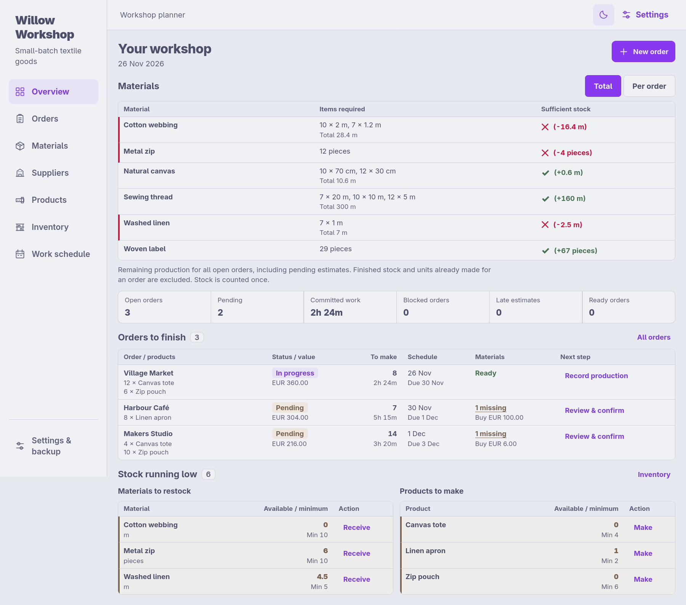
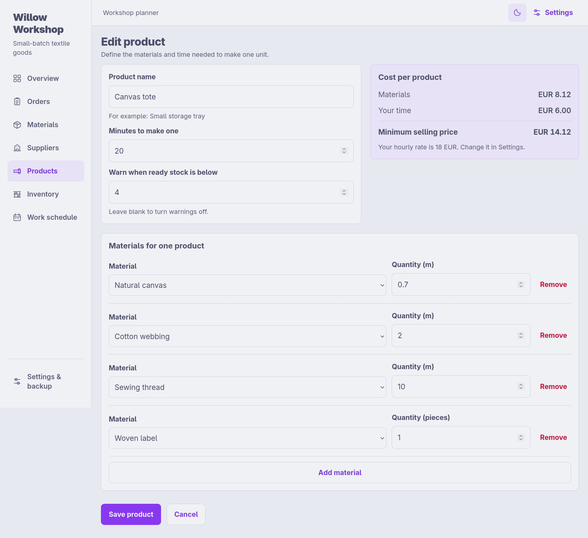
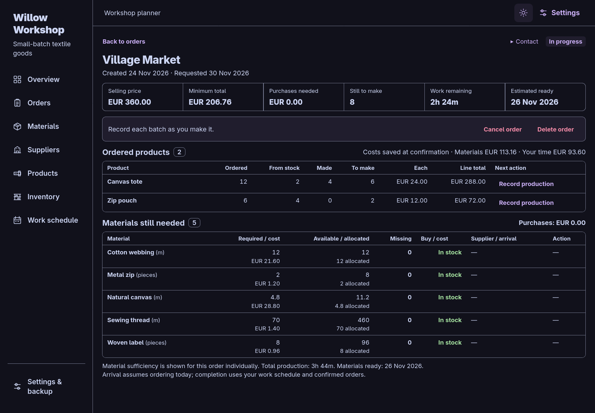
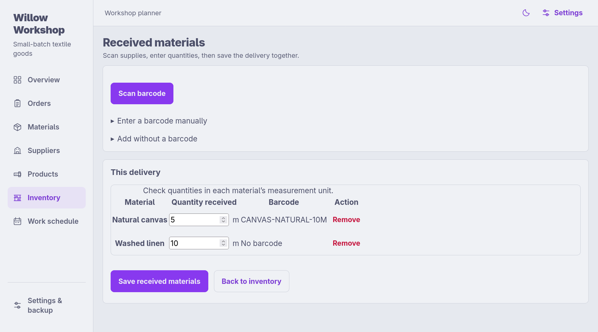
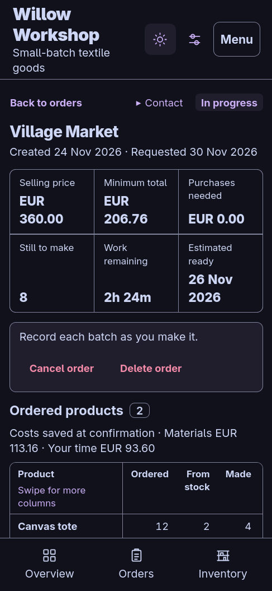

# Smerp

Smerp is a planner for small workshops. Track your supplies, calculate what each product costs to make, manage customer orders, and see what you need to buy and produce.

Use it on Windows, macOS or Linux, in an app window or your web browser. You can also open the same workshop from a phone or tablet.



*Screenshots show an example workshop.*

## Start Smerp

Extract the package for your computer, then open the app:

| Computer | Package | Start |
| --- | --- | --- |
| Windows 10/11, 64-bit | `Smerp-windows-amd64.zip` | Open `smerp.exe`. |
| Mac, Intel or Apple Silicon, macOS 12+ | `Smerp-macos-universal.zip` | Copy `Smerp.app` to Applications and open it. |
| Linux, 64-bit | `Smerp-linux-amd64.tar.gz` | Run `./smerp` from the extracted folder. |

If you have the source code instead of a package, follow [Build Smerp](docs/building.md).

Windows and Linux open your browser at **http://127.0.0.1:3210**. The Mac app opens its own window. Your first workshop is empty; follow the setup steps below.

For a dedicated window on Windows, run `.\smerp.exe -mode window` in PowerShell; on Linux, run `./smerp -mode window`. For browser mode on a Mac, run `/Applications/Smerp.app/Contents/MacOS/smerp -mode browser` in Terminal.

Closing a browser tab leaves Smerp running. Stop it with **Ctrl+C** in its terminal when you finish. Closing the dedicated app window stops Smerp.

### If the app will not open

- **Windows app window:** install the [Microsoft WebView2 Runtime](https://developer.microsoft.com/en-us/microsoft-edge/webview2/#download) if Smerp reports that it is missing.
- **Mac:** the supplied app is not notarized. If macOS blocks its first launch, follow [Apple's instructions for opening an app you trust](https://support.apple.com/en-us/102445).
- **Linux:** install the runtime libraries below. The supplied package needs glibc 2.34 or newer.

```sh
# Debian / Ubuntu
sudo apt install libgtk-3-0 libwebkit2gtk-4.1-0

# Fedora
sudo dnf install gtk3 webkit2gtk4.1
```

If port 3210 is already in use, check whether Smerp is already running and open its address. To use another port, start it with `-listen 127.0.0.1:3211`.

## Set up your workshop

1. Open **Settings**. Set your workshop title, **Currency code** and **Your pay per hour**. The hourly rate is how much your production time should earn.
2. Open **Work schedule**. Enter the hours you can work on each day and add any dates off. Smerp uses these to estimate when orders will be ready.
3. In **Suppliers**, add each supplier's contact details and delivery time in business days.
4. In **Materials**, add your supplies. Choose a supplier and measurement unit, then enter the purchase quantity and its price. For a 10 m roll costing EUR 60, enter **10** as the purchase quantity and **60** as the price; Smerp calculates the cost per metre.
5. In **Inventory**, use **Correct count** to enter what is already on the shelf. Enter the total you counted, rather than the amount to add.
6. In **Products**, add what you make. Enter the minutes needed for one unit and the materials used in that one unit.

You can set low-stock warning levels on materials and products. Leave the warning field blank to turn it off.

## Work out a product's price

Open **Products → New product**, or edit an existing product. Add a material row for each ingredient and enter the quantity used in one finished item. The cost panel updates as you edit.



**Minimum selling price** covers the materials and your time, rounded upward to the next cent. In this example, EUR 8.12 of materials plus EUR 6.00 of work gives a minimum of **EUR 14.12**.

Set the selling price when you enter an order. Allow for your desired profit and any costs you need to cover beyond materials and production time, such as packaging, postage or tax.

Changing the currency changes the labels; it does not convert existing amounts.

## Take an order from quote to handover

1. Choose **New order**. Enter the customer, an optional requested date, and the products, quantities and agreed prices. Save the order.
2. Review its costs, materials and estimated ready date. A **Pending** order is a quote and does not reserve stock. You can still edit it.
3. When the customer accepts, choose **Confirm and reserve stock**. Smerp reserves available finished products and materials. The recipe, costs, hourly rate and currency are saved for this order.
4. As you finish a batch, choose **Record production** next to that product on the order. Enter the number you made. Smerp deducts its materials and holds the finished items for the customer. You can record several batches.
5. When everything is ready, choose **Complete and hand over**. The delivered products leave inventory and the order becomes **Completed**.



If finished products arrive separately after you confirm an order, receive them in **Inventory**. They can fulfil that order through **Complete and hand over** once there are enough available.

**Cancel order** releases unused reservations. Materials already used stay used, and products already made stay in stock. **Delete order** removes the order without reversing stock changes or erasing stock history.

## See what needs buying and making

The **Overview** brings together material requirements, orders waiting to be finished, remaining production time and low-stock warnings. Open an order to see its own materials, purchase suggestions and next action.

The material tabs answer two different questions:

- **Total:** is there enough stock for all open orders together? Stock is counted once.
- **Per order:** is there enough for each order considered on its own?

For example, with 10 m of fabric and two orders needing 6 m each, each order has enough when viewed individually. The total view shows a 2 m shortage. Materials reserved for a confirmed order remain protected when you record production for another order.

Purchase suggestions round missing material up to complete supplier packs. Arrival estimates assume you buy today and use the supplier's Monday–Friday delivery time. Completion estimates also use your work schedule, dates off and confirmed workload. They assume the full working hours set for today are available.

## Receive supplies

Open **Inventory → Received materials**:

1. Choose **Scan barcode** and allow camera access. Alternatively, expand **Enter a barcode manually**, choose its format, enter the code and press **Find barcode**. Use **Add without a barcode** to choose a material directly.
2. Enter the quantity received in the material's unit, then choose **Add to delivery**.
3. Repeat for the other items in the delivery. An unfamiliar barcode can be assigned to an existing material or used to add a new material.
4. Review **This delivery** and choose **Save received materials**. Stock changes only when you save the delivery.



For a 10 m roll of fabric, receive **10 m**, rather than one roll. Material quantities can be fractional; finished-product counts are whole numbers.

Supported codes are EAN-13, EAN-8, UPC-A, UPC-E and QR. A material can have several codes; edit its material record to manage them. QR contents identify a supply and are never opened as links.

Camera scanning needs permission and an HTTPS address or localhost. Manual entry and ordinary forms work over local-network HTTP. Press **Scan barcode** again to deliberately scan the same code a second time.

## Keep inventory accurate

**Inventory** shows three quantities:

| Quantity | Meaning |
| --- | --- |
| On shelf | Everything physically in stock. |
| Reserved | Stock held for confirmed orders. |
| Available | Stock left for other work after reservations. |

Use **Receive** to add stock and **Correct count** to replace the recorded total with a physical count. Add a reason for a correction so it is clear in **Recent stock changes**. Counts cannot be reduced below reserved quantities.

For products made for general stock, use **Make**. For a customer's order, record production from that order so the finished products stay assigned to it. Use **Receive** when finished products arrive without being made from your stored materials.

## Use your phone or tablet

Run Smerp on the computer that holds your workshop, allowing access on your network:

```sh
./smerp -listen 0.0.0.0:3210
```

On Windows, use `.\smerp.exe -listen 0.0.0.0:3210`. On a Mac, use `/Applications/Smerp.app/Contents/MacOS/smerp -mode browser -listen 0.0.0.0:3210`.

Allow that port through the host computer's firewall on your trusted network. On your phone, open `http://COMPUTER-IP:3210`, replacing `COMPUTER-IP` with that computer's local IP address. Bookmark it. The computer must stay on, awake and running Smerp.

On small screens, use the bottom navigation for **Overview**, **Orders** and **Inventory**, and open **Menu** for the other pages. Swipe wide tables sideways for more columns. The sun/moon button switches between light and dark modes; your choice is remembered on each browser or device.



Anyone who can reach the app can edit the workshop. Keep direct access on a trusted network. Phone camera scanning needs HTTPS. For access away from the workshop, protect the HTTPS address with external access control; see [HTTPS access](docs/building.md#https-access).

If an older form reports that something changed on another device, review the latest values before saving again.

## Back up and restore your workshop

Open **Settings → Backup and restore** and choose **Download backup**. Keep a copy somewhere other than the computer running Smerp.

To restore one, select the file under **Restore a backup** and choose **Preview backup**. Review the summary, then choose **Replace and restore**. Restoring replaces the current workshop, including inventory, orders and settings.

If Smerp reports that its working file needs attention, download the original file from the recovery screen, then restore a valid backup.

Your workshop is saved on the computer running Smerp. The default file location is:

| Computer | Data file |
| --- | --- |
| Windows | `%AppData%\smerp\workshop.json` |
| Mac | `~/Library/Application Support/smerp/workshop.json` |
| Linux | `~/.config/smerp/workshop.json`, or `$XDG_CONFIG_HOME/smerp/workshop.json` when set |

To choose another location, start Smerp with `-data PATH`. Use one running Smerp process for each data file and connect your other devices to that process.

[Build and run options](docs/building.md) · [Behaviour reference](docs/behaviour.md) · [Third-party notices](licenses/README.md)
